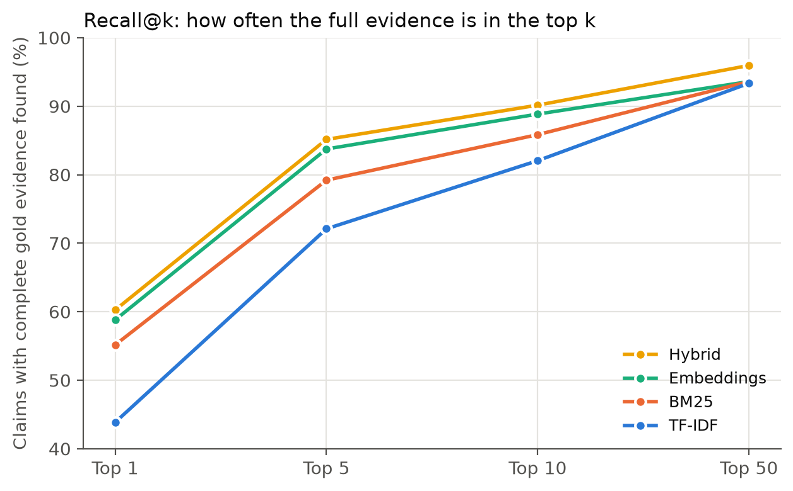
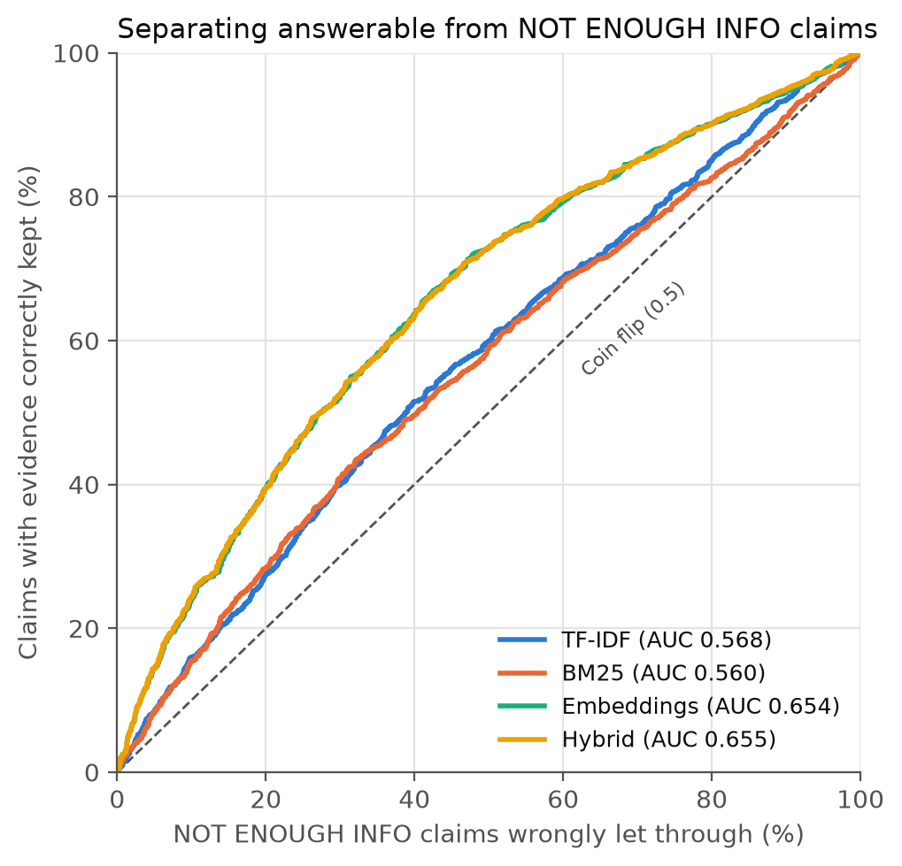

## Retriever comparison (validation, 2,000 claims with evidence, 2,000 NOT ENOUGH INFO claims, 156,302 passages)

| Retriever | R@1 | R@5 | R@10 | R@50 | Page@5 | MRR | ROC-AUC | ms/claim |
|---|---:|---:|---:|---:|---:|---:|---:|---:|
| TF-IDF | 43.9% | 72.1% | 82.0% | 93.3% | 93.8% | 0.627 | 0.568 | **0.92** |
| BM25 | 55.1% | 79.2% | 85.9% | 93.6% | 96.0% | 0.724 | 0.560 | 3.45 |
| Embeddings | 58.8% | 83.8% | 88.8% | 93.6% | 98.0% | 0.767 | 0.654 | 1.94 |
| Hybrid | **60.2%** | **85.2%** | **90.1%** | **96.0%** | **98.8%** | **0.777** | **0.655** | 7.37 |

Bold = best in column. R@k = complete gold evidence set in the top k.

## Threshold sweep

| Retriever | Keep rate | Cutoff | With evidence kept | NEI blocked |
|---|---:|---:|---:|---:|
| TF-IDF | 80% | 0.3381 | 80.0% | 25.6% |
| TF-IDF | 85% | 0.3170 | 85.0% | 20.1% |
| TF-IDF | 90% | 0.2921 | 90.0% | 14.2% |
| TF-IDF | 95% | 0.2635 | 95.0% | 8.5% |
| TF-IDF | 99% | 0.2154 | 99.0% | 1.7% |
| BM25 | 80% | 8.8821 | 80.0% | 23.8% |
| BM25 | 85% | 8.2339 | 85.0% | 16.6% |
| BM25 | 90% | 7.5326 | 90.0% | 10.9% |
| BM25 | 95% | 6.5466 | 95.0% | 5.7% |
| BM25 | 99% | 5.3759 | 99.0% | 1.1% |
| Embeddings | 80% | 0.6672 | 80.0% | 39.1% |
| Embeddings | 85% | 0.6445 | 85.0% | 30.1% |
| Embeddings | 90% | 0.6137 | 90.0% | 20.8% |
| Embeddings | 95% | 0.5701 | 95.0% | 9.1% |
| Embeddings | 99% | 0.5087 | 99.0% | 2.5% |
| Hybrid | 80% | 0.6632 | 80.0% | 39.6% |
| Hybrid | 85% | 0.6389 | 85.0% | 30.0% |
| Hybrid | 90% | 0.6078 | 90.0% | 20.3% |
| Hybrid | 95% | 0.5629 | 95.0% | 9.9% |
| Hybrid | 99% | 0.4983 | 99.0% | 2.8% |

## Charts

