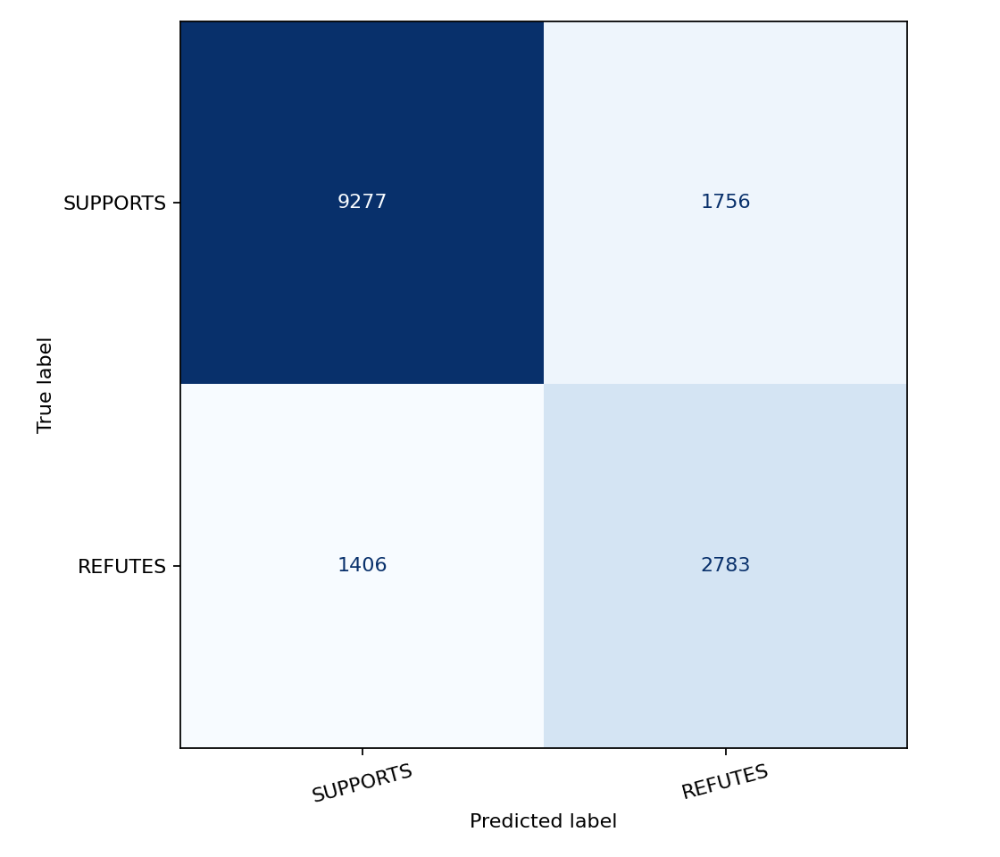
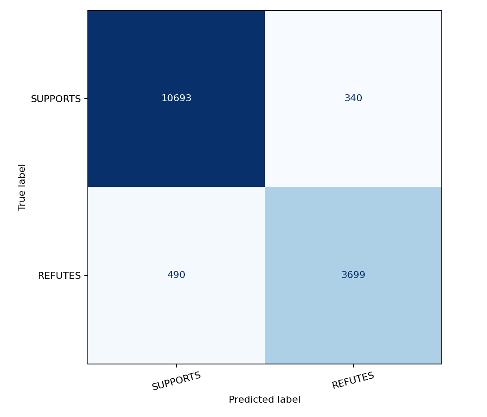
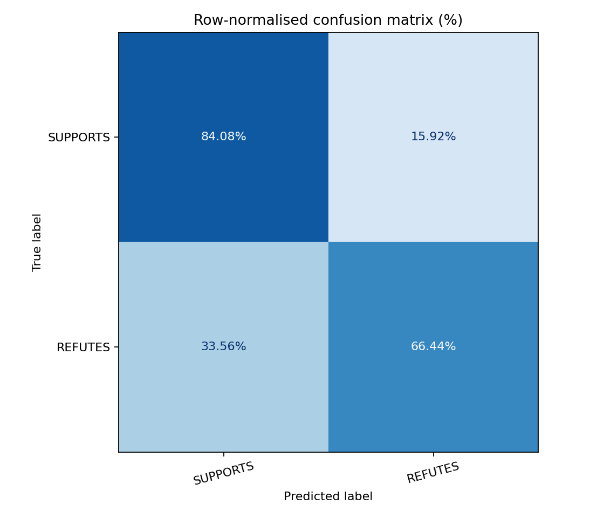
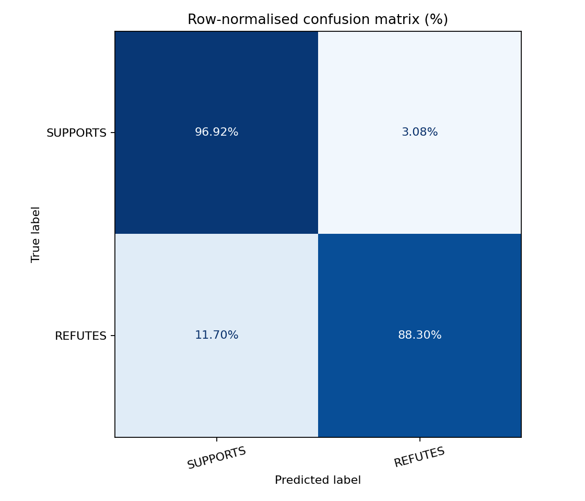

# TrueCheck

**An Explainable Misinformation & Claim-Verification Assistant**

*NAT820S · Natural Language Processing and Applications*
*Group Project · Semester 2, 2026*

## Table of Contents

- [Project Overview](#project-overview)
- [Project Requirements](#project-requirements)
- [Original FEVER Dataset](#original-fever-dataset)
- [Dataset Preparation and Exploration](#dataset-preparation-and-exploration)
- [Annotated Evidence Preparation](#annotated-evidence-preparation)
- [Classical Model Training](#classical-model-training)
- [Transformer Model Training](#transformer-model-training)
- [Model Evaluation and Comparison](#model-evaluation-and-comparison)
- [Evidence Retrieval](#evidence-retrieval)

## Project Overview

False or misleading claims spread quickly on social media and messaging apps, and readers often have no easy way to check whether a claim is well supported.

This project builds a prototype that takes a short claim or headline and returns a verdict (e.g., likely true/likely false/unverified) with plain-language reasoning and links to supporting or contradicting evidence, rather than a bare label.

## Project Requirements

1. **Claim classification**
   Compare and implement at least one classical ML approach and one deep-learning/transformer approach to classify a claim or article by truthfulness label, using the chosen dataset.

2. **Text representation**
   Justify the chosen embeddings/features for this task.

3. **Evidence retrieval (RAG-style)**
   For a new claim, retrieve the most relevant supporting or contradicting passages from a small evidence corpus using a similarity index.

4. **Explainable verdict generation**
   Use an LLM, prompted to reason only over the retrieved evidence, to produce a short plain-language explanation for the verdict, explicitly citing which retrieved passage supports it, and clearly flagging when there is not enough evidence to decide.

5. **Bias & error analysis**
   Test the classifier across at least two claim categories or topics and report where accuracy or false-positive/negative rates differ meaningfully.

6. **Multilingual consideration**
   Discuss, or where feasible, test how the pipeline would need to change for a claim written in a language other than English.

7. **Guardrails**
   The system must never present an unverified LLM guess as a “fact-checked” verdict; if retrieval finds no relevant evidence, it must say so rather than fabricating a verdict.

8. **Evaluation**
   Report standard classification metrics (accuracy, F1, precision/recall per class) and, for the RAG explanation component, spot-check whether generated explanations are actually grounded in the retrieved evidence.

## Original FEVER Dataset

The project will use the FEVER fact-verification dataset, which contains claims paired with Wikipedia evidence. The original dataset files belong in `Dataset/Original/`.

| Resource | File | Download |
| --- | --- | --- |
| Training dataset | `train.jsonl` | [Download](https://fever.ai/download/fever/train.jsonl) |
| Labelled development dataset | `shared_task_dev.jsonl` | [Download](https://fever.ai/download/fever/shared_task_dev.jsonl) |
| Wikipedia evidence corpus | `wiki-pages.zip` | [Download](https://fever.ai/download/fever/wiki-pages.zip) |

The original training file has 145,449 records with `id`, `claim`, `label`, `verifiable` and `evidence` fields:

| Label | Original records | Percentage |
|---|---:|---:|
| SUPPORTS | 80,035 | 55.03% |
| NOT ENOUGH INFO | 35,639 | 24.50% |
| REFUTES | 29,775 | 20.47% |
| **Total** | **145,449** | **100.00%** |

## Project Structure

The `Dataset` folder structure must exist first because it is excluded by `.gitignore`, while the Python scripts and other tracked project files are already included in the repository.

```text
Dataset/
├── Cache/
├── Original/
│   ├── shared_task_dev.jsonl
│   ├── train.jsonl
│   └── wiki-pages.zip
└── Processed/
```

## Dataset Preparation and Exploration

**Python file:** [prepare_dataset.py](Python%20Scripts/prepare_dataset.py)

Validate and clean `Dataset/Original/train.jsonl`, handle duplicates, and save `train.csv`, `validation.csv` and `test.csv` directly in `Dataset/Processed/`.

### Cleaning and Duplicate Handling

- Trim leading/trailing whitespace while preserving the original claim wording, capitalisation, punctuation, numbers, negation and stopwords. No stemming or lemmatisation.
- Exclude empty or invalid claims. Stop on invalid/duplicate IDs or unexpected labels; report annotation issues separately.
- Detect duplicates using exact claim text, normalised text, and full untruncated BERT token sequences. Normalisation is used only for matching.
- For confirmed same-label duplicates, keep the lowest-ID record and preserve all original evidence annotations.
- Exclude entire duplicate groups if labels conflict or the match is considered questionable.

### Classes and Split Assignments

The saved datasets contain **SUPPORTS** and **REFUTES**. **NOT ENOUGH INFO** is excluded because it has no usable annotated supporting/refuting evidence.Giving it empty evidence would allow the classifier to learn an empty-input shortcut. The final application will handle insufficient evidence separately using retrieval and evidence-sufficiency checks before issuing a verdict.

Use stratified **70% training / 15% validation / 15% test**, with **seed 42** and records sorted by ID.

### Data Leakage Checks

Duplicate records are handled before the data is split. The script then checks that the training, validation and test sets do not contain the same claims in different forms:

- **Record IDs:** the same ID cannot appear more than once.
- **Normalised claim text:** claims that are the same after basic text normalisation cannot appear in different splits.
- **Duplicate groups:** records identified as duplicates cannot be spread across different splits.
- **BERT token sequences:** claims that produce the same full BERT token sequence cannot appear in different splits.

If any of these checks fail, dataset preparation stops.

### Dataset Preparation Results

The original FEVER training file contained **145,449 records**:

- **SUPPORTS:** 80,035 (55.03%)
- **REFUTES:** 29,775 (20.47%)
- **NOT ENOUGH INFO:** 35,639 (24.50%)

After cleaning and duplicate handling:

- **8,090** duplicate copies were removed.
- **2,559** records were excluded because duplicate groups had conflicting labels.
- **71** records were excluded because the duplicate match was uncertain.
- **134,729** records remained across all three original classes.

After removing **NOT ENOUGH INFO**, the final dataset contained **101,479 records**:

| Split | Total | SUPPORTS | REFUTES |
|---|---:|---:|---:|
| Training | 71,035 | 51,486 | 19,549 |
| Validation | 15,222 | 11,033 | 4,189 |
| Test | 15,222 | 11,033 | 4,189 |
| **Total** | **101,479** | **73,552** | **27,927** |

### Saved Files

The script creates:

```text
Dataset/Processed/train.csv
Dataset/Processed/validation.csv
Dataset/Processed/test.csv
```

Each file contains:

| Column | Purpose |
|---|---|
| `id` | Original FEVER record ID |
| `claim` | Claim text |
| `label` | SUPPORTS or REFUTES |
| `annotation_records` | Original evidence references |
| `tokenizer_revision` | BERT tokenizer version used during preparation |

Rerunning `prepare_dataset.py` replaces all three CSVs, so `prepare_evidence.py` must be run again afterwards.

```powershell
.\.venv\Scripts\python.exe "Python Scripts/prepare_dataset.py"
```

## Annotated Evidence Preparation

**Python file:** [prepare_evidence.py](Python%20Scripts/prepare_evidence.py)

Reads the three split CSVs and resolve all complete annotated evidence sets using `wiki-pages.zip`. Combines unique evidence sentences while preserving the original source references and complete evidence-set memberships.

Each claim remains one dataset row. All unique evidence sentences associated with that claim are stored together in a single multiline `evidence` cell. Each line follows the general format:

```text
<Page Title>: <Evidence sentence>
```

A real example from the prepared training data is claim ID `14`:

```text
Claim: There have been many notable performances by David Thewlis.
Class: SUPPORTS

Evidence:
David Thewlis: His most commercially successful role to date has been that of Remus Lupin in the Harry Potter film series .
David Thewlis: Other notable performances include the films Naked ( for which he won the Best Actor award at Cannes Film Festival ) , Dragonheart , Kingdom of Heaven , The Boy in the Striped Pyjamas , The Theory of Everything , Black Beauty , and Macbeth ( in which he played King Duncan ) .
```

The script overwrites `Dataset/Processed/train.csv`, `validation.csv` and `test.csv` in place, adding evidence to those same files rather than creating another set of datasets.

The script adds these columns:

| Column             | Purpose                                                                                                                              |
| ------------------ | ------------------------------------------------------------------------------------------------------------------------------------ |
| `evidence`         | Multiline formatted evidence text supplied to both models                                                                            |
| `evidence_sources` | JSON containing complete evidence sets, page/sentence IDs and source URLs; retained as metadata and not used as model input features |

### BERT Input Lengths

Before replacing the processed CSV files, the script checks every claim and its evidence with the configured BERT tokenizer.

| Split | Fit one 512-token input | Require multiple chunks | Maximum chunks | Maximum full tokens |
| --- | ---: | ---: | ---: | ---: |
| Training | 70,269 / 71,035 (98.92%) | 766 | 5 | 1,987 |
| Validation | 15,055 / 15,222 (98.90%) | 167 | 4 | 1,609 |
| Test | 15,062 / 15,222 (98.95%) | 160 | 5 | 2,176 |

Overall, **100,386 of 101,479 claims** fit within one 512-token claim-and-evidence input. The remaining **1,093 claims** require multiple chunks.

Evidence is never silently truncated. Inputs that exceed the limit are split into multiple chunks, and dataset replacement stops if any claim cannot be encoded correctly.

### Final Prepared Dataset

After dataset cleaning, duplicate handling, class filtering and evidence preparation, the final processed dataset contains **101,479 claims** across the original train, validation and test splits.

| Split | Total | SUPPORTS | REFUTES |
| --- | ---: | ---: | ---: |
| Training | 71,035 | 51,486 | 19,549 |
| Validation | 15,222 | 11,033 | 4,189 |
| Test | 15,222 | 11,033 | 4,189 |
| **Total** | **101,479** | **73,552** | **27,927** |

The final files are:

```text
Dataset/Processed/train.csv
Dataset/Processed/validation.csv
Dataset/Processed/test.csv
```

```powershell
.\.venv\Scripts\python.exe "Python Scripts/prepare_evidence.py"
```

## Classical Model Training

**Python file:** [train_classical.py](Python%20Scripts/train_classical.py)

Train **TF-IDF + Logistic Regression** using both claim and annotated evidence text. Separate TF-IDF vectorizers represent the two fields, and their feature matrices are combined for classification. Vocabulary and IDF statistics are fitted on training data only.

| Setting | Value |
|---|---|
| Word n-grams | (1, 2) |
| Maximum vocabulary | 50,000 per vectorizer |
| Minimum / maximum document frequency | 2 / 1.0 |
| Lowercase | Enabled |
| Stopword removal | None |
| Sublinear TF / smoothed IDF / L2 normalisation | Enabled |
| Logistic Regression regularisation / solver | L2 / lbfgs |
| Candidate C values | 0.1, 1.0, 10.0 |
| Class weights | Balanced |
| Maximum iterations / tolerance | 1,000 / 1e-4 |
| Random seed | 42 |

Each `C` candidate is trained on the same training features and evaluated on the validation split using macro F1. The candidate with the highest validation macro F1 is retained, an exact tie keeps the smaller `C`. Training stops if Logistic Regression fails to converge.

### Training Results

All three candidates converged successfully:

| C | Validation Macro F1 | Iterations |
|---:|---:|---:|
| 0.1 | 72.78% | 19 |
| 1.0 | 74.25% | 19 |
| **10.0** | **74.54%** | **69** |

The selected model used **C = 10.0**.

Validation performance on **15,222 records**:

| Overall Metric | Result |
|---|---:|
| Accuracy | 79.03% |
| Macro F1 | 74.54% |

| Class | Precision | Recall | F1 |
|---|---:|---:|---:|
| SUPPORTS | 87.05% | 83.49% | 85.23% |
| REFUTES | 60.75% | 67.27% | 63.84% |

The fitted claim TF-IDF vectorizer, evidence TF-IDF vectorizer and Logistic Regression classifier are saved together in `Models\binary_evidence_classical\runs\<run_id>\model.joblib`. The run also stores its configuration, training history, validation summary and integrity hashes.

```powershell
.\.venv\Scripts\python.exe "Python Scripts/train_classical.py"
```

## Transformer Model Training

**Python file:** [train_transformer.py](Python%20Scripts/train_transformer.py)

Fine-tune **BERT** using the same claim and annotated evidence records. Claim and evidence are encoded as a sequence pair.

| Setting | Value |
|---|---|
| Pretrained model | bert-base-uncased, pinned revision |
| Maximum input length | 512 tokens including claim and special tokens |
| Batch size / gradient accumulation | 8 claims / 2 batches |
| Effective target batch size | 16 claims |
| Maximum epochs / early-stopping patience | 5 / 2 |
| Optimizer / learning rate | AdamW / constant 2e-5 |
| Weight decay | 0.01, excluding biases and LayerNorm scales |
| AdamW betas / epsilon | (0.9, 0.999) / 1e-8 |
| Gradient clipping | 1.0 |
| Loss | Class-weighted cross-entropy |
| Precision / padding | Float32 / dynamic |
| Gradient checkpointing | Enabled, non-reentrant |
| Random seed | 42 |

If an input fits within 512 tokens, BERT processes one chunk. Longer evidence is divided into multiple chunks. Each chunk contains the claim, and all chunks are retained. Their logits are averaged to produce one prediction and one weighted loss per claim.

Validation runs after each epoch using macro F1. The checkpoint with the highest validation macro F1 is retained. An exact tie keeps the earlier epoch. Training stops after two consecutive non-improving epochs or five epochs, whichever comes first.

### Training Results

Training stopped after epoch 4 because validation macro F1 did not improve for two consecutive epochs:

| Epoch | Weighted Training Loss | Validation Macro F1 |
|---:|---:|---:|
| 1 | 0.2881 | 92.50% |
| **2** | **0.1981** | **93.04%** |
| 3 | 0.1515 | 93.04% |
| 4 | 0.1151 | 92.82% |

The selected model was from **epoch 2**. Its unrounded validation macro F1 was slightly higher than epoch 3.

Validation performance on **15,222 records**:

| Overall Metric | Result |
|---|---:|
| Accuracy | 94.50% |
| Macro F1 | 93.04% |

| Class | Precision | Recall | F1 |
|---|---:|---:|---:|
| SUPPORTS | 95.69% | 96.77% | 96.23% |
| REFUTES | 91.24% | 88.52% | 89.86% |

The selected BERT model and tokenizer are saved under:

```text
Models\binary_evidence_bert\runs\<run_id>\checkpoint\
```

The checkpoint contains the fine-tuned model weights, model configuration and tokenizer files.

At successful completion, the selected run is automatically locked for later test evaluation.

```powershell
.\.venv\Scripts\python.exe "Python Scripts/train_transformer.py" --device cuda
```

## Model Evaluation

**Python file:** [evaluate_models.py](Python%20Scripts/evaluate_models.py)

Evaluate the selected and automatically locked classical and BERT models on the held-out test set.

### Test Results

Both models were evaluated on the same **15,222 test claims**.

**Test Confusion Matrices (Raw Counts)**

<table>
<tr>
<th>Classical Model</th>
<th>BERT Model</th>
</tr>
<tr>
<td></td>
<td></td>
</tr>
</table>

**Normalised Confusion Matrices (%)**

<table>
<tr>
<th>Classical Model</th>
<th>BERT Model</th>
</tr>
<tr>
<td></td>
<td></td>
</tr>
</table>

#### Overall Performance

| Metric | Classical | BERT |
| --- | ---: | ---: |
| Accuracy | 79.23% | **94.55%** |
| Macro F1 | 74.61% | **93.09%** |

#### Per-Class Performance

| Class | Metric | Classical | BERT |
| --- | --- | ---: | ---: |
| SUPPORTS | Precision | 86.84% | **95.62%** |
| SUPPORTS | Recall | 84.08% | **96.92%** |
| SUPPORTS | F1 | 85.44% | **96.26%** |
| REFUTES | Precision | 61.31% | **91.58%** |
| REFUTES | Recall | 66.44% | **88.30%** |
| REFUTES | F1 | 63.77% | **89.91%** |

### Saved Test Results

Test metrics are saved separately for each model.

**Classical**

```text
Evaluation\binary_evidence_classical\runs\<run_id>\test\
```

**BERT**

```text
Evaluation\binary_evidence_bert\runs\<run_id>\test\
```

Each folder contains:

- `metrics.json` — overall and per-class metrics
- `predictions.csv` — individual predictions and class probabilities
- `confusion_matrix.csv` — raw confusion matrix counts
- `confusion_matrix.png` — plotted confusion matrix

```powershell
.\.venv\Scripts\python.exe "Python Scripts/evaluate_models.py" --experiment all --device cuda
```

`all` evaluates the two claim + evidence models. Classical inference runs on CPU, and CUDA is used for BERT.

## TODO: Evidence Retrieval

Add retrieval for new user claims so the application can find relevant supporting or contradicting evidence and determine whether enough evidence is available for classification.

`prepare_evidence.py` only resolves FEVER's existing annotated evidence and is not the retrieval system used for new claims.